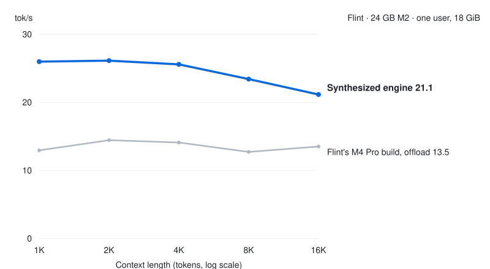

# Flint on a 24 GB M2

An OpenAI-compatible server for [Flint](https://huggingface.co/RecursiveSI/flint-int4), Recursive's int4
mixture-of-experts model (22.6 GB), tuned on a 24 GB M2, where the model does not fit in memory.

- **2.1× llama.cpp** at its fastest GPU-layer setting, on raw decoding at a 1K-token prompt: 28.2 vs. 13.6 tok/s (3.4× at 8K).
  [rec](https://github.com/recursive-oss/rec), Recursive's own inference engine for Flint, needs 27.8 GB at 1K of context and does
  not run on a 24 GB Mac.
- **2.3× Flint's [M4 Pro build](../flint-m4pro)** in the same 18 GiB on this Mac, averaged over code and raw at 1K and
  8K, with the same output bit for bit.
- Serves one user at a time. On a 32 GB Mac, [`install.sh`](../../install.sh) sets a 26 GiB budget, which plans the whole model and 73,728 tokens
  of history in memory. We ran that plan on our 48 GB M4 Pro with its GPU limit set to a 32 GB Mac's, not on a 32 GB Mac.

<p align="center">
  <picture>
    <source media="(prefers-color-scheme: dark)" srcset="../../assets/serve-flint-m2-dark.svg">
    <source media="(prefers-color-scheme: light)" srcset="../../assets/serve-flint-m2-light.svg">
    
  </picture>
</p>

## Quick start

You need Python 3.14 or newer and 22.6 GB of disk for the model. From this directory:

```bash
python3.14 -m venv .venv && source .venv/bin/activate
pip install '.[download]'
hf download RecursiveSI/flint-int4 --revision 3b93f9053b530488405ae9fca51d4900d6ce21f0 \
    --local-dir ~/models/flint-int4
sudo sysctl iogpu.wired_limit_mb=22528     # on a 24 GB Mac: raise the GPU wired limit until the next restart
jitengine-flint-m2 serve --model-path ~/models/flint-int4
```

Put the checkpoint on the internal SSD, because every expert missing from memory is read from it during decode. The default 18 GiB budget needs the raised GPU wired limit. Without it, the budget is the smaller limit macOS recommends, which would keep fewer experts in memory and decode more slowly, as the 12 GiB rows do ([memory budget](DETAILS.md#memory-budget)). Then point any OpenAI client at `http://127.0.0.1:8080/v1`:

```bash
curl -N http://127.0.0.1:8080/v1/chat/completions -H 'Content-Type: application/json' \
    -d '{"messages": [{"role": "user", "content": "Hello!"}], "stream": true}'
```

To drive it with a coding agent, run [`jit-launch pi`](../../launch), or `claude`, `codex` or
`opencode`.

## Results

Decode speed in tok/s on a 24 GB M2, for one stream. Code is a real coding prompt; raw is a random prompt and a fixed stream of random tokens.

| Budget | Workload | This engine | Flint M4 Pro build, offload |
|:--|:--|--:|--:|
| 18 GiB | code, 1K | **20.6** | 8.5 |
| 18 GiB | code, 8K | **20.0** | 8.0 |
| 18 GiB | raw, 1K | **28.2** | 12.8 |
| 18 GiB | raw, 8K | **24.9** | 11.5 |
| 12 GiB | code, 1K | **9.1** | 5.0 |
| 12 GiB | code, 8K | **8.4** | 4.7 |
| 12 GiB | raw, 1K | **13.9** | 7.0 |
| 12 GiB | raw, 8K | **12.9** | 6.5 |

At 1K tokens of context, this engine is 2.4× the M4 Pro build on code (20.6 tok/s) and 2.2× raw (28.2 tok/s). The
table is the run's scored medians, with both builds measured in the same session; the chart is raw decoding from 1K to
16K tokens, both builds back to back. Within 18 GiB the engine keeps 73% of the 12,032 routed experts in memory.
llama.cpp, with Recursive's Q4_1 GGUF, decodes 13.6 tok/s raw at 1K and 7.35 tok/s at 8K. That is its fastest setting among the
GPU-layer counts we swept (0, 10, 15, 20, 30, 35 and 40; 45 and more ran out of GPU memory), and it puts every layer on
the CPU. We did not vary its 4 threads. [DETAILS.md](DETAILS.md#results) has its settings, peak memory and the bit-identity check.

## Why it's fast

At 22.6 GB, Flint overflows the M2's 18 GiB, so the engine reads the experts that do not fit from the SSD when the
router picks them. This build is the [M4 Pro build](../flint-m4pro)'s offload mode, tuned for the M2.
Run unchanged on this Mac (18 GiB, code at 1K), a token took 116 ms. A profile of the same setting, at 124 ms per token, put 45 ms in blocking reads of the experts
missing from memory, 16 ms in choosing which expert to evict, and 18.5 ms in extra GPU time that followed the reads.
The run kept nine changes; four of them:

1. A helper process keeps the GPU clock up. Offload sends the GPU short bursts of work, one per layer, and between
   bursts the M2 holds its GPU clock at about 800 of its 1,398 MHz. The helper streams tiny kernels on its own GPU
   queue while a request runs, and shares no memory with the engine, so it cannot change the output. Code at 1K went
   from 9.3 to 13.6 tok/s.
2. The engine starts each layer's experts on the GPU before the CPU has confirmed they are in memory, from a copy of
   where the experts sit. Starting early added 9 to 18% at 18 GiB. When the check finds an expert missing, the engine redoes only that
   expert's rows, which added a further 1 to 2%.
3. Four small changes freed memory for more experts. The loader's staging buffer is released after loading, MLX's
   buffer cache is emptied before the engine sizes its expert space, and the reserves for MLX's cache and for reading
   the next prompt shrank to the measured peaks. Code at 1K gained 12% at 18 GiB.
4. A missing expert is stored as nine separate tensors in the checkpoint, and eight workers now read them at the same
   time instead of one after another. The expert to drop is found without sorting every slot in the pool.

[DETAILS.md](DETAILS.md#why-its-fast-in-more-detail) has all nine changes with the gain from each.

## Options

`serve --help` lists every option. The ones you would set:

| Option | Default | What it sets |
|:--|:--|:--|
| `--model-path DIR` | required | the checkpoint directory |
| `--memory-budget-gib N` | the wired limit, at most memory less 6 GiB | the memory the engine may use |
| `--mode auto\|resident\|offload` | `auto` | whether experts stream from the SSD |
| `--context-limit auto\|N` | `auto` (32,768 in offload) | history positions |
| `--max-queued N` | 8 | requests that may wait; more get 429 |
| `--host`, `--port` | `127.0.0.1`, `8080` | where the server listens |
| `--allowed-host NAME` | none | a host name clients may use besides `localhost`, IP literals and `--host` (repeatable); a request naming any other host, or sent by a browser page of another origin, gets 403 |

[DETAILS.md](DETAILS.md) has the rest: the full option table and the subcommands, memory budgets, the environment variables, how to reproduce the numbers, and the Macs it was tested on.

## Test

```bash
pip install '.[dev]' && pytest     # unit tests; the Metal and e2e tests skip without Metal or the checkpoint
```

A pass is every test passing or skipping. On the M2 with the checkpoint, the end-to-end test checks that greedy
output hashes to `46cc7a346d0ee2fb`. [`tests/README.md`](tests/README.md) says what each suite checks and what it
needs.

Built with [SkyDiscover](https://skydiscover-ai.github.io/).
