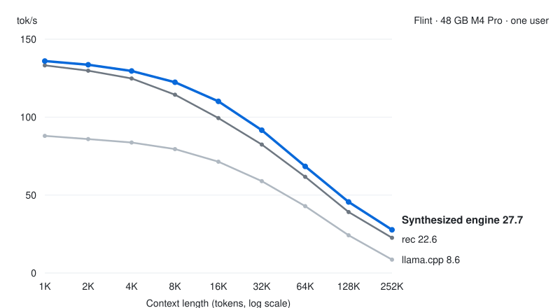

# Flint on a 48 GB M4 Pro

An OpenAI-compatible server for [Flint](https://huggingface.co/RecursiveSI/flint-int4), Recursive's int4
mixture-of-experts model, tuned on a 48 GB M4 Pro.

- **22% faster than rec at 252K tokens of context**, for one user: 27.7 vs. 22.6 tok/s.
  [rec](https://github.com/recursive-oss/rec) is Recursive's own inference engine for Flint.
  The two are level at a 1K-token prompt (136.0 vs. 133.2 tok/s), and the lead grows with context.
- **48% faster than rec on greedy code** at 252K (33.4 vs. 22.6 tok/s), where rec decodes code no faster than raw
  text. Code often repeats earlier text, and the engine turns that into more than one token per pass, with every token
  still the one plain decoding would give.
- Serves one user at a time, at contexts up to 262,144 tokens (252K, the longest measured, is 258,048). With the whole
  model in memory it needs 24.1 to 31.0 GiB of GPU memory, depending on the context limit. We measured it on our 48 GB
  M4 Pro only; on other Macs it checks its kernel when it loads and falls back to stock MLX if the check fails
  ([other Macs](DETAILS.md#other-macs)). With less memory, the [M2 build](../flint-m2) streams experts from the SSD
  faster than this one ([less memory](DETAILS.md#less-memory)).

<p align="center">
  <picture>
    <source media="(prefers-color-scheme: dark)" srcset="../../assets/serve-flint-dark.svg">
    <source media="(prefers-color-scheme: light)" srcset="../../assets/serve-flint-light.svg">
    
  </picture>
</p>

## Quick start

You need Python 3.14 or newer and 22.6 GB of disk for the model. From this directory:

```bash
python3.14 -m venv .venv && source .venv/bin/activate
pip install '.[download]'
hf download RecursiveSI/flint-int4 --revision 3b93f9053b530488405ae9fca51d4900d6ce21f0 \
    --local-dir ~/models/flint-int4                                               # 22.6 GB
jitengine-flint-m4pro serve --model-path ~/models/flint-int4
```

It serves one request at a time and queues up to 8 more. Point any OpenAI client at
`http://127.0.0.1:8080/v1`:

```bash
curl -N http://127.0.0.1:8080/v1/chat/completions -H 'Content-Type: application/json' \
    -d '{"messages": [{"role": "user", "content": "Hello!"}], "stream": true}'
```

To drive it with a coding agent, run [`jit-launch pi`](../../launch), or `claude`, `codex` or
`opencode`.

## Results

Decode speed in tok/s on a 48 GB M4 Pro, for one stream with prefill excluded. Each cell is the median of 5 runs of
1,024 decode steps.

| Context | Raw | rec, raw¹ | llama.cpp² | Code, greedy | Code, sampled |
|--:|--:|--:|--:|--:|--:|
| 1K | **136.0** | 133.2 | 88.0 | 152.1 | 156.6 |
| 2K | **133.6** | 129.8 | 85.9 | 135.4 | 138.7 |
| 4K | **129.6** | 124.8 | 83.7 | 139.2 | 137.3 |
| 8K | **122.4** | 114.4 | 79.5 | 124.3 | 124.2 |
| 16K | **110.1** | 99.4 | 71.4 | 114.3 | 113.2 |
| 32K | **91.6** | 82.4 | 58.9 | 96.9 | 97.2 |
| 64K | **68.4** | 61.7 | 42.9 | 95.8 | 78.3 |
| 128K | **45.6** | 39.1 | 24.2 | 57.9 | 55.9 |
| 252K | **27.7** | 22.6 | 8.6 | 33.4 | 30.5 |

Raw is one model pass per token on random text. Code is a real coding prompt and the model's own
continuation. The footnotes ¹ and ² (which rec and llama.cpp builds, and how the numbers were taken) and the memory figures are in [DETAILS.md](DETAILS.md#results).

## Why it's fast

At long context, reading the history sets the pace. At 252K tokens, each new token rereads about 7.4 GB of history,
the stored keys and values of the 14 full-attention layers. It also reads 1.45 GB of weights. The M4 Pro's memory delivers
259 GB/s, so reading the history takes about 29 of the 36 ms per token.

1. The engine reads each slice of history once for all the heads that share it. In each layer, eight query heads share
   the same stored keys and values (grouped-query attention). 240 simdgroups (32-thread warps, 6 in each of the
   40 threadgroups) split the history, and each computes its eight heads as one small matrix multiply on the GPU's matrix units. History streams at 251 to
   255 GB/s. The M4 Pro's memory measured 259 GB/s, so that is 97 to 98% of it. This layout was the largest gain at
   long context, 11.9% at 32K.
2. Each decode pass runs as one persistent Metal kernel, a single GPU program for the whole pass, as in rec. A chain of
   separate kernels would need 293 GPU launches per pass, and those launches cost 2.09 to 2.32 ms even when empty. The
   kernel also draws sampled tokens itself, so sampling adds no round trip to the host.
3. The kernel's stages pass flags to each other instead of stopping at barriers, where every threadgroup on the GPU
   waits for the slowest. Barriers fell from 342 to 150 per pass, and that change drew level with rec at short context.
4. On code, the engine guesses from earlier text and checks every guess in one pass. When the latest tokens match
   earlier text, it guesses that the next few tokens repeat what followed there, and keeps a guess only if it is
   exactly the token the model picks. rec does not do this.

The [M2 build](../flint-m2), for a Mac that cannot hold the model, reads experts from the SSD on stock MLX operations
instead of this kernel. [DETAILS.md](DETAILS.md#why-its-fast-in-more-detail) has the rest.

## Options

`serve --help` lists every option. The ones you would set:

| Option | Default | What it sets |
|:--|:--|:--|
| `--model-path DIR` | required | the checkpoint directory |
| `--context-limit auto\|N` | `auto` | history positions |
| `--memory-budget-gib N` | the whole model, or the wired limit | the memory the engine may use |
| `--profile main\|kv8` | `main` | 16-bit or 8-bit history for the full-attention layers |
| `--max-queued N` | 8 | requests that may wait; more get 429 |
| `--host`, `--port` | `127.0.0.1`, `8080` | where the server listens |
| `--allowed-host NAME` | none | a host name clients may use besides `localhost`, IP literals and `--host` (repeatable); a request naming any other host, or sent by a browser page of another origin, gets 403 |

[DETAILS.md](DETAILS.md) has the rest: every option and subcommand, the server's request handling,
running with less memory, other Macs, how to reproduce the numbers, and the Macs it was tested on.

## Test

```bash
pip install '.[dev]' && pytest     # unit tests; the Metal and e2e tests skip without Metal or the checkpoint
```

A pass is every test passing or skipping. On the M4 Pro with the checkpoint, the end-to-end test checks that greedy
output hashes to `22f2f2ab929aa000`. [`tests/README.md`](tests/README.md) says what each suite checks.

Built with [SkyDiscover](https://skydiscover-ai.github.io/).
