# Qwen3.6-35B-A3B on a 24 GB M2

An OpenAI-compatible server for Qwen3.6-35B-A3B with 3-bit weights, tuned on a 24 GB M2 Mac.

- **36% faster for one user** than llama.cpp with multi-token prediction (MTP), the fastest other server we
  measured that fits in 18 GiB: 44.9 vs. 32.9 tok/s.
- **44.4 tok/s in total for eight agents** on held-out prompts, ahead of every other server that fits in the same
  18 GiB.
- Needs a Mac with 24 GB or more. We measured it on a 24 GB M2. On other Macs it checks its custom kernels against
  stock MLX when it loads, and runs stock MLX for any that disagree.

<p align="center">
  <picture>
    <source media="(prefers-color-scheme: dark)" srcset="../../assets/serve-qwen36-dark.svg">
    <source media="(prefers-color-scheme: light)" srcset="../../assets/serve-qwen36-light.svg">
    
  </picture>
</p>

## Quick start

You need Python 3.14 or newer and 15.2 GB of disk for the model. From this directory:

```bash
python3.14 -m venv .venv && source .venv/bin/activate
pip install '.[download]'
hf download andrevp/Qwen3.6-35B-A3B-3bit-MLX --revision 794408c4b69a90c9a7b96d3fce6949cccf08df85 \
    --local-dir ~/models/Qwen3.6-35B-A3B-3bit
jitengine-qwen3.6-35b-a3b-m2 serve --model-path ~/models/Qwen3.6-35B-A3B-3bit --profile 24gb-static
```

The model stays in memory within 18 GiB, leaving 6 GiB for macOS, so close most apps first. Then
point any OpenAI client at `http://127.0.0.1:8080/v1`:

```bash
curl -N http://127.0.0.1:8080/v1/chat/completions -H 'Content-Type: application/json' \
    -d '{"messages": [{"role": "user", "content": "Hello!"}], "stream": true}'
```

For a coding agent, add `--max-context 32768 --prefix-cache-mib 1024 --build-expert-pack` to `serve`, then run
[`jit-launch pi`](../../launch), or `claude`, `codex` or `opencode`. The 1 GiB prefix cache lets each turn read only
the new part of its prompt: a 10,561-token turn read its prompt in 10.7 s instead of 47.1 s, with the same reply. It
also leaves memory for only part of the model, so the first start writes a 14 GB expert pack to `~/.cache/jitengine`
and the rest of the experts stream from it.

## Results

Decode speed in tok/s on a 24 GB M2 Mac, 3-bit, within 18 GiB.

| Server | 1 user | 8 agents |
|:--|--:|--:|
| **This engine** | **44.9** | **44.4** |
| llama.cpp + MTP, 1 slot | 32.9 | not measured |
| mlx-lm 0.31.3 | 30.0 | 24.0 |
| vllm-mlx 0.6.0 | 27.7 | over 18 GiB |
| Ollama 0.40.6, one request at a time | 25.4 | 22.1 |
| llama.cpp, 8 slots | 24.8 | 41.4 |
| vLLM-Metal 0.31.0 | 18.4 | over 18 GiB |

"8 agents" is the total over eight requests at once, on held-out prompts (absent from the benchmark's default
draw, which the run used to score each change). Every number in the table was measured with the server within
18 GiB, through the same benchmark client. The engine passes all 42 prompts of the same-output check against
mlx-lm: 39 match token for token, and 3 differ only at near-ties in mlx-lm's own top scores. [DETAILS.md](DETAILS.md#results) says how each server ran and why SGLang and mistral.rs are missing.

## Why it's fast

On this Mac the GPU spends its time issuing the instructions that unpack 3-bit weights, and memory bandwidth is
left over. The M2's memory delivers about 93 GB/s, but stock MLX's 3-bit weight multiply moves weights at only
68 GB/s. The weights are stored in 3 bits to fit in 18 GiB (the router gates stay at 8 bits), and the GPU has to unpack
each one before it can multiply. The coding agents kept eleven changes that make each pass cheaper, and the total for eight agents went from
32.6 to 44.9 tok/s on the scored prompts (the benchmark's default draw). Three of them:

1. The engine prepares each input once. MLX's 3-bit kernel rescales the same slice of input in every threadgroup (a
   CUDA thread block); a small kernel now does it once, ahead of the multiply. An 8192 × 2048 weight multiply drops
   from 0.108 to 0.0886 ms, and weights move at 82 GB/s instead of 68. The scale is a power of two, so every product
   is exact and the output does not change by a bit.
2. Each expert call names only the expert it reads. MLX closes a command buffer (a batch of GPU work the CPU submits
   at once) after 40 operations or 40 MB of declared inputs. Each expert call declared the whole 235 MB stack of
   experts, so every call got a buffer to itself. With one expert declared, up to 100 operations share a buffer, and
   one user's step drops from 22.05 to 20.03 ms. The price is about 1 GB more peak memory.
3. With eight requests in one step, every pair of request and expert gets its own threadgroup. The requests mostly
   pick different experts, and a kernel that walked them in turn left GPU cores idle. This took eight agents from
   43.97 to 44.90 tok/s.

The coding agents also built MTP, which guesses the next token and checks the guess in the next pass, and left it
off. Checking one guess costs 65 to 73% of a step here, so a right guess at best breaks even. The
[M4 Pro build](../qwen3.6-35b-a3b-m4pro), where the check costs about 21%, turns it on.
[DETAILS.md](DETAILS.md#why-its-fast-in-more-detail) lists all eleven changes in order.

## Options

`serve --help` lists every option. The ones you would set:

| Option | Default | What it sets |
|:--|:--|:--|
| `--profile` | none | `24gb-static` (18 GiB, with the model in memory when it fits) or `24gb-adaptive` (experts read from the SSD) |
| `--memory-budget-gib` | 18 | the most memory the server may use |
| `--max-slots` | 8 | requests decoded at once |
| `--max-context` | 8192 | prompt plus output tokens |
| `--host`, `--port` | `127.0.0.1`, `8080` | where the server listens |
| `--allowed-host NAME` | none | a host name clients may use besides `localhost`, IP literals and `--host` (repeatable); a request naming any other host, or sent by a browser page of another origin, gets 403 |

[DETAILS.md](DETAILS.md) has the rest: every option and subcommand, running with less memory or a
4-bit checkpoint, how to reproduce the numbers, and the Macs it was tested on.

## Test

```bash
pip install '.[dev]' && pytest     # the Metal and end-to-end tests skip without Metal or the checkpoint
```

A pass is every test passing or skipping. On the M2 with the checkpoint, the end-to-end test also checks that greedy
output hashes to `44e24c591fc59187`. [`tests/README.md`](tests/README.md) says what each suite checks.

Built with [SkySynth](https://skydiscover-ai.github.io/blog-skysynth.html).
