# Qwen3.6-35B-A3B on a 48 GB M4 Pro

An OpenAI-compatible server for Qwen3.6-35B-A3B with 4-bit weights, tuned on a 48 GB M4 Pro.

- **10% faster for eight agents** on the scored prompts than oMLX's best mode for eight requests: 200.5 vs.
  181.5 tok/s.
- **194.6 tok/s for one user**, below oMLX with MTP's 217.2, and the only server measured here whose output passes
  the same-output check.
- Needs a Mac with 32 GB or more. We measured it on a 48 GB M4 Pro and ran its Metal tests on a 24 GB M2. On other
  Macs it checks its custom kernels against stock MLX when it loads, and runs stock MLX for any that disagree. Below
  40 GB it needs a budget of memory less 6 GiB, and on 32 GB the GPU wired limit raised
  ([DETAILS.md](DETAILS.md#install)).

<p align="center">
  <picture>
    <source media="(prefers-color-scheme: dark)" srcset="../../assets/serve-qwen36-m4pro-dark.svg">
    <source media="(prefers-color-scheme: light)" srcset="../../assets/serve-qwen36-m4pro-light.svg">
    
  </picture>
</p>

## Quick start

You need Python 3.14 or newer, and disk for the model (20.4 GB) and its MTP head (0.5 GB). From this
directory:

```bash
python3.14 -m venv .venv && source .venv/bin/activate
pip install '.[download]'
hf download mlx-community/Qwen3.6-35B-A3B-4bit --revision 38740b847e4cb78f352aba30aa41c76e08e6eb46 \
    --local-dir ~/models/Qwen3.6-35B-A3B-4bit                                     # 20.4 GB
hf download mlx-community/Qwen3.6-35B-A3B-MTP-4bit --revision 0295b81421bf4d0fccca9a7c0fcfb1418dda3516 \
    --local-dir ~/models/Qwen3.6-35B-A3B-MTP-4bit                                 # 0.5 GB
jitengine-qwen3.6-35b-a3b-m4pro serve --model-path ~/models/Qwen3.6-35B-A3B-4bit
```

The 4-bit conversion drops the MTP head, so the second download supplies it. The engine looks for it
beside the checkpoint (`…-4bit` next to `…-MTP-4bit`). Then point any OpenAI client at
`http://127.0.0.1:8080/v1`:

```bash
curl -N http://127.0.0.1:8080/v1/chat/completions -H 'Content-Type: application/json' \
    -d '{"messages": [{"role": "user", "content": "Hello!"}], "stream": true}'
```

To drive it with a coding agent, add `--max-context 32768` to `serve` (the default holds 8K tokens
a request) and run [`jit-launch pi`](../../launch), or `claude`, `codex` or `opencode`.

## Results

Decode speed in tok/s on a 48 GB M4 Pro, 4-bit, with the model in memory.

| Server | 1 user | 8 agents | 8 agents, held out | Same-output check |
|:--|--:|--:|--:|:--|
| **This engine, exact** | 194.6 | **200.5** | 139.8 | **pass** |
| This engine, `--profile relaxed` | **225.1** | 198.6 | **139.9** | fail |
| oMLX 0.7.1, VLM engine with MTP | 217.2 | 135.0 | 85.8 | fail |
| oMLX 0.7.1, text engine | 93.9 | 181.5 | 103.3 | fail |
| oMLX 0.7.1, text engine with MTP | 173.1 | no valid run | 83.4 | fail |
| vllm-mlx 0.6.0 | 58.8 | 55.4 | 55.8 | fail |

"8 agents" is the total over eight requests at once on the scored prompts, the benchmark's own draw, and "held out"
uses prompts absent from that draw. The same-output check compares greedy output with mlx-lm's, token for token,
except where the top tokens' scores are nearly tied. `--profile relaxed` and oMLX's VLM engine with MTP are faster for one
user but fail it. The one-user column is a greedy 512-token reply that rewrites code from its prompt, which suits guessing.
In other measurements, one user got 172 to 179 tok/s when a reply repeats its prompt and about 125 when it does not.
[DETAILS.md](DETAILS.md#results) has the notes on how each server ran.

## Why it's fast

Reading one token's weights from memory takes about 6.4 ms of the 11.1 ms a one-token pass takes. A guessed second token
shares the 1.10 GB of dense weights with the first, so a pass that also checks one guess takes only 13.4 ms. The engine therefore guesses on
every pass. Starting from the M2 build, the tuning run
raised the total for eight agents on this Mac from 155.3 to 200.5 tok/s.

1. The model's multi-token prediction (MTP) head guesses the next token, and the next pass checks the guess while it
   computes a new one. Guesses are right often enough for about 1.85 tokens per pass.
2. The checking kernels give each of the two tokens exactly the arithmetic of one-token decoding. MLX's faster
   multi-token kernels round differently, which can change which token wins, so every output here is bit-identical
   to plain decoding. `--profile relaxed` uses MLX's kernels below 6 rows and its own faster kernel from 6, neither exact: 225.1 tok/s for
   one user, but it fails the same-output check.
3. When a reply repeats text from its prompt, the engine also guesses by copying what followed that text there, and
   checks those guesses the same exact way.
4. Attention stays exact past the switch to two passes. On this GPU, MLX switches to a two-pass attention kernel at
   1,024 tokens of history, where the M2 build's exact kernel stopped matching it. The engine copies MLX's one-pass
   kernel line for line and its two-pass kernel with the same arithmetic, with the same switch, so they keep stock's
   bits while reading each request's KV buffer in place. The tests compare them with stock at lengths from 7 to
   20,000 tokens.

The [M2 build](../qwen3.6-35b-a3b-m2) this one started from leaves MTP out, because there checking one guess costs 65
to 73% of a step against about 21% here. [DETAILS.md](DETAILS.md#why-its-fast-in-more-detail) has the rest.

## Options

`serve --help` lists every option. The ones you would set:

| Option | Default | What it sets |
|:--|:--|:--|
| `--memory-budget-gib` | 34 on a Mac with 40 GiB or more, else 18 | the most memory the server may use |
| `--max-slots` | 8 | requests decoded at once |
| `--max-context` | 8192 | prompt plus output tokens |
| `--profile` | none | `relaxed` (faster, fails the same-output check), or `24gb-static` and `24gb-adaptive` for 24 GB Macs |
| `--host`, `--port` | `127.0.0.1`, `8080` | where the server listens |
| `--allowed-host NAME` | none | a host name clients may use besides `localhost`, IP literals and `--host` (repeatable); a request naming any other host, or sent by a browser page of another origin, gets 403 |

[DETAILS.md](DETAILS.md) has the rest: every option and subcommand, the profiles, environment
variables, how to reproduce the numbers, and the Macs it was tested on.

## Test

```bash
pip install '.[dev]' && pytest     # unit tests; the Metal and e2e tests skip without Metal or the checkpoint
```

A pass is every test passing or skipping. On the M4 Pro with the checkpoint, the end-to-end test also checks that
greedy output hashes to `44d9aee27f3f890e`. [`tests/README.md`](tests/README.md) says what each suite checks, what it
needs, and the variables that point it at a checkpoint.

Built with [SkySynth](https://skydiscover-ai.github.io/blog-skysynth.html).
