# Qwen3.8-Flash-Next on a 24 GB M2

An OpenAI-compatible server for Qwen3.8-Flash-Next, a 112 GB model with 4-bit weights, tuned on a 24 GB M2 Mac.
Most of its experts stay on the SSD.

- **62% faster for one user** than slotstream, an open-source Mac engine that runs this model from
  the SSD ([carloslfu/slotstream](https://github.com/carloslfu/slotstream)), at an 18 GB budget: 4.48 vs. 2.76 tok/s.
- Faster on this Mac than the 48 GB M4 Pro engine it started from, run unchanged (4.07 tok/s), with the model on the internal SSD.
- Needs an 18 GB memory budget and about 220 GB free on the internal SSD. We measured it on a 24 GB M2, and in a
  budget sweep on a 48 GB M4 Pro (2026-11-03).

<p align="center">
  <picture>
    <source media="(prefers-color-scheme: dark)" srcset="../../assets/serve-flashnext-m2b-dark.svg">
    <source media="(prefers-color-scheme: light)" srcset="../../assets/serve-flashnext-m2b-light.svg">
    
  </picture>
</p>

## Quick start

You need Python 3.14 and about 220 GB free on the internal SSD. From this directory:

```bash
python3.14 -m venv .venv && source .venv/bin/activate
pip install '.[download]'
export JITENGINE_QWEN3_8_FLASH_NEXT_M2_PACK_DIR=~/models/flashnext-pack
hf download mlx-community/Qwen3.8-Flash-Next-4bit --revision 07b5dc6c54600a359b87f1e53e7adf6351c72a2c \
    --local-dir ~/models/Qwen3.8-Flash-Next-4bit                                # 112 GB, once
jitengine-qwen3.8-flash-next-m2 pack --model-path ~/models/Qwen3.8-Flash-Next-4bit   # 108 GB, once
jitengine-qwen3.8-flash-next-m2 serve --model-path ~/models/Qwen3.8-Flash-Next-4bit
```

The default budget, 18 GB (16.8 GiB), is the one the M2 was measured at. It stays under the 80% of memory
above which the engine refuses a budget, because macOS needs the rest. `--memory-budget-gb 16` is the
other measured budget. Then point any OpenAI client at `http://127.0.0.1:8080/v1`:

```bash
curl -N http://127.0.0.1:8080/v1/chat/completions -H 'Content-Type: application/json' \
    -d '{"messages": [{"role": "user", "content": "Hello!"}], "stream": true}'
```

The server also speaks the Anthropic Messages and OpenAI Responses APIs, which we tested with their SDKs.
[`jit-launch`](../../launch) can point Claude Code, Codex, OpenCode or Pi at it; we have not run those agents on this
engine. [DETAILS.md](DETAILS.md#server) says what context a request gets.

## Results

Decode speed in tok/s on a 24 GB M2 Mac, with the 112 GB 4-bit model streamed from the internal SSD.

| Server | 1 user, 18 GB |
|:--|--:|
| **This engine** | **4.48** |
| M4 Pro engine, unmodified | 4.07 |
| slotstream 0.2.30, MTP off | 2.76 |

[DETAILS.md](DETAILS.md#results) has the 16 GB budget and the notes. In our budget sweep of 2026-11-03,
this build at 18 GB took 100.2 s to the first token for a prompt of about 1K tokens and 473.0 s for about 8K. That
sweep ran on an EC2 Mac whose model sits on a network-attached (EBS) disk.

## Why it's fast

Here SSD reads set the pace. A token costs about 50 ms of computing plus about 1.71 ms for each expert read from
the SSD. The M2 gives the engine 18 GB instead of the M4 Pro's 40 GB, so it misses more often. Its SSD also reads these
experts at 1.79 GB/s instead of 4.66, so each miss costs more. The M4 Pro engine, moved over unchanged, read about 113
experts per token: about 190 ms of reading in a token that took about 245 ms. This build reads about 95.

1. The engine drops the experts needed last. Each token's pass runs through the 48 layers in order, so an expert of
   the layer that just ran is not needed again until the next token reaches that layer, while experts of the layers
   still ahead are needed sooner. Evicting the least recently used expert would drop exactly the experts needed next.
   The engine drops the just-used ones first. In a trace replay at 3,561 pool slots, misses per step were 121.9 with
   least-recently-used and 112.6 with the least-used rule the M4 Pro build then had. This rule, which looks back over
   64 tokens, had 110.3 (107.8 with a 32-token window), and an oracle that knows the future would have 58.3.
2. The token embedding is read from the SSD too, which frees memory for more experts.
3. While one layer's experts are being read, the engine starts reading the experts the next layer is predicted to
   need.
4. With eight requests at once, the engine takes turns. The requests barely share experts, so a batched step loads
   eight sets that push one another out. The engine decodes one request for 64 tokens before switching, which cut SSD
   reads per token from 243.5 to 140.9.

The [M4 Pro build](../qwen3.8-flash-next-m4pro) guesses ahead with the model's multi-token-prediction head; in a
trace replay of it on the M2's 18 GB plan (assuming 88% of guesses are right), SSD misses per generated token rose 14
to 33%, so this build does not guess. The expert offloading
builds on the design of [FreeToken](https://github.com/FlashML-org/FreeToken)
([paper](https://arxiv.org/abs/2608.16157)) by Shuo Yang and colleagues: one expert cache shared by all layers,
whole-layer streaming for prefill, and memory traded between the expert cache and the KV cache.

## Options

`serve --help` lists every option. The ones you would set:

| Option | Default | What it sets |
|:--|:--|:--|
| `--model-path` | required | the checkpoint directory |
| `--memory-budget-gb`, `--memory-budget-gib` | 18 GB (16.8 GiB) | the memory budget, in decimal GB or in GiB |
| `--force` | off | allow a budget above 80% of memory |
| `--max-slots` | 8 | concurrent request slots |
| `--host`, `--port` | `127.0.0.1`, `8080` | where the server listens |
| `--allowed-host NAME` | none | a host name clients may use besides `localhost`, IP literals and `--host` (repeatable); a request naming any other host, or sent by a browser page of another origin, gets 403 |

[DETAILS.md](DETAILS.md) has the rest: every option and subcommand, the environment variables, how to reproduce the numbers, and the Macs it was tested on.

## Test

```bash
pip install '.[dev]' && pytest     # unit tests (on Linux, see tests/README.md for MLX); the Metal and e2e tests skip without Metal or the checkpoint
```

A pass is every test passing or skipping. On the 24 GB M2 with the checkpoint, the end-to-end test checks that greedy output hashes to `af6575a8e19ef6d5`. [`tests/README.md`](tests/README.md) says what each suite checks.

Built with [SkyDiscover](https://skydiscover-ai.github.io/).
