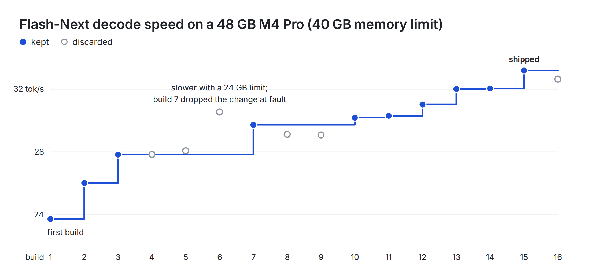

# Qwen3.8-Flash-Next on a 48 GB M4 Pro: details

The [README](README.md) has the quick start and the results. This page has the rest.

- [Install](#install)
- [Server](#server)
- [Options](#options)
- [Results](#results)
- [Why it's fast, in more detail](#why-its-fast-in-more-detail)
- [Measure it yourself](#measure-it-yourself)
- [Tested on](#tested-on)

## Install

Python 3.14 and about 290 GB free on the internal SSD, or 220 GB without the optional pack16 file. The README's commands (venv, `pip install '.[download]'`, the download and `pack --mtp --pack16`) are all of it. `pack` checks 64 records of each expert pack byte for byte against the checkpoint (`--verify N` changes the count) and every record of the pack16 file; the engine only reads them.

`--mtp` also builds the multi-token-prediction head, `mtp.safetensors` beside the checkpoint. The
4-bit checkpoint leaves the head out, so `pack` reads its 31 tensors from the official bf16 release
(`Qwen/Qwen3.8-Flash-Next` at a pinned revision, 4.9 GB by HTTP range request), folds and quantizes
them as slotstream's converter does, and writes 1.5 GB. Without the head the engine decodes one token
per pass. `--pack16` also writes the optional compact-record file (68 GB, below).

## Server

```bash
jitengine-qwen3.8-flash-next-m4pro serve --model-path ~/models/Qwen3.8-Flash-Next-4bit --memory-budget-gib 29.8
```

The server listens on `127.0.0.1:8080`. `--memory-budget-gib` is the memory the engine may use, and
the README's table lists the budgets we measured. The default is 62% of memory, and a budget above 80% is
refused unless `--force`. Nothing needs sudo. `--log-level debug` prints the whole memory plan and
every kernel choice, and `warning` only what needs attention.

### Coding agents

A chat request's `tools` go to the checkpoint's template, and the calls in the
reply come back as OpenAI `tool_calls`. The same port serves the Anthropic Messages API
(`/v1/messages`, `/v1/messages/count_tokens`) and OpenAI's Responses API (`/v1/responses`) on the
same chat. We tested these endpoints with the OpenAI and Anthropic SDKs, and we have not run Claude Code, Codex,
OpenCode or Pi on this engine. [`launch/`](../../launch) and `jit-launch` set those agents up. One request holds at most the KV budget (`--kv-budget-mb`) and a
32K-token prompt; `/v1/models` reports the smaller as `max_model_len`, which the launcher sizes the
agent's context to.

## Options

`serve --help` lists every option. The ones you are likely to set:

| Option | Default | What it sets |
|:--|:--|:--|
| `--model-path` | required | the checkpoint directory |
| `--host`, `--port` | `127.0.0.1`, `8080` | the listen address |
| `--allowed-host` | none | a host name clients may use besides `localhost`, IP literals and `--host` (repeatable); requests naming any other host, and browser requests from other origins, get 403 |
| `--memory-budget-gib`, `--memory-budget-gb` | 62% of memory | the memory budget in GiB or in decimal GB (not both) |
| `--force` | off | allow a budget above 80% of memory |
| `--expert-pack-path`, `--ple-pack-path` | none | pack files, in place of the ones found through the variables below |
| `--max-slots` | 8 | concurrent rows |
| `--kv-budget-mb` | planned from the memory budget | the live attention KV budget in MB |
| `--prefix-grid-tokens`, `--prefix-min-divergence-tokens` | 2048, 256 | the prefix store's snapshot grid and minimum divergence |
| `--compute-dtype`, `--residual-dtype`, `--moe-kernel`, `--dense-kernel` | `float32`, the compute dtype, `grouped`, `rb` | numeric type and kernel choices |
| `--wave-width`, `--admit-warm-quiet-s` | the value of `--max-slots`, 0.1 s | the prefill wave size and the arrival window |
| `--store-spill` | `on` | lend the prefix store's memory to the expert cache while one user decodes (`on`) or keep it resident (`off`) |
| `--draft-vocab` | `subset` | the MTP draft's readout: the shipped top-K token ids plus the request's prompt ids (`subset`) or every token (`full`); output is identical either way |
| `--embed-stream`, `--embed-cache-rows` | `on`, 8192 | read token-embedding rows from the checkpoint (`on`) or hold the table (`off`); the rows its cache keeps |
| `--pack16-disk` | `on` | read compact expert records from the optional pack16 file when it validates (`on`) or always read the expert pack (`off`) |
| `--mtp-min-slots` | 10500 | expert slots one user's decode needs before it drafts with the MTP head |
| `--expert-pool-evict` | `cyc64` | one user's eviction rule: `cyc64`, by the layer cycle, or `decay32`, least used |
| `--ple-prefetch`, `--ple-host-context` | `on` | the PLE layer's reads issued at round start, and its context made on the host |
| `--log-level` | `info` | `debug`, `info` or `warning` |

Other subcommands: `doctor` (platform, MLX and Metal), `inspect` (the memory plan a budget gives),
`status` (health and memory of a running server) and `pack` (`--mtp` for the draft head, `--pack16`
for the compact-record file).

Environment variables:

- `JITENGINE_QWEN3_8_FLASH_NEXT_M4PRO_PACK_DIR`: the directory holding the packs, each named after its checkpoint.
- `JITENGINE_QWEN3_8_FLASH_NEXT_M4PRO_EXPERT_PACK`: one expert pack file, in place of the one the directory would name.
- `JITENGINE_QWEN3_8_FLASH_NEXT_M4PRO_PLE_PACK`: one PLE pack file, in place of the one the directory would name.
- `JITENGINE_QWEN3_8_FLASH_NEXT_M4PRO_MTP_PATH`: the multi-token-prediction head's file, in place of `mtp.safetensors` beside the checkpoint.
- `JITENGINE_QWEN3_8_FLASH_NEXT_M4PRO_PLE_PREFETCH`, `JITENGINE_QWEN3_8_FLASH_NEXT_M4PRO_PLE_HOST_CONTEXT`: `on` or `off`, the defaults of the two PLE flags.
- `JITENGINE_QWEN3_8_FLASH_NEXT_M4PRO_LOGITS_DIGEST`: a file; when set, the sha256 of every logits row a token is drawn from is appended to it, to check bit-identity between builds.
- `MLX_MAX_OPS_PER_BUFFER`: MLX's command-buffer size; the engine sets it to 10 unless you set it first.

## Results

Decode speed in tok/s on a 48 GB M4 Pro, for one user at four memory budgets. This is how the [README](README.md#results)'s numbers were measured.

- A smaller budget stands in for a smaller Mac's memory, not its GPU or SSD. Every row used the
  pack16 file, so each needed about 290 GB free on the SSD (220 GB without it).
- The budgets were measured in decimal GB: `--memory-budget-gb 40` gives the 40 GB row's plan to the
  byte.
- Every row ran with the MTP head (`pack --mtp`) and the pack16 file (`pack --pack16`) in place. The
  40 GB row comes from the run's last head-to-head session: this build against the engine before it,
  launched in turns, four pairs, 32.94 against 23.83 tok/s (each the median of its runs' medians). This package's
  own run at 40 GB read 33.2. The other rows are one run each of the published client (the median
  of three repeats).
- slotstream ran in earlier sessions, on September 23. The 40 GB row is slotstream 0.2.11 with its MTP on (11.0 tok/s
  with it off); we did not rerun newer versions. The [M2 build](../qwen3.8-flash-next-m2)'s baseline is slotstream 0.2.30, so the two builds'
  baselines used different slotstream versions. In one
  session side by side with it on September 23, an earlier build decoded 21.6 tok/s to slotstream's 12.1
  (1.8×). On September 17 and 18, llama.cpp on the CPU decoded 2.7, and mlx-lm, mlx-vlm, oMLX and ds4 could
  not run the model on this Mac; we did not retry later versions.

## Why it's fast, in more detail

The [README](README.md#why-its-fast) has the short version. The 112 GB model does not fit in memory. Each token uses
480 experts (10 in each of 48 layers), and nearly all of them must already be in memory.

- In an earlier build that decoded 23.4 to 23.8 tok/s, at 3 MB per expert, a 40 GB budget held 11,347 of the 24,576
  experts (46%), which served 97.9% of expert reads from memory, about 10 SSD reads per token. A profile of a still
  earlier build, which decoded about 16 tok/s, shows where the time went: 62.6 ms per token, against 27.8 ms for the
  same pass with no SSD reads and no waiting. In each layer the CPU asked the GPU which experts the router had picked
  (a round trip of about 100 µs), looked them up and only then queued their work. Waiting on the router came to
  24.5 ms per token, and fusing GPU kernels barely helped (62.6 to 62.0 ms).
- The GPU computes first and the CPU checks after. The GPU's copy of the slot map lets a layer's experts run before
  the CPU sees the router's choice. The cache can hand a slot to another expert while the GPU still reads from it, so every early
  read records which expert it found in each slot, and the check recomputes any expert whose slot changed hands. The
  engine also queues the next layer before checking the current one, and rolls it back when a miss changed its
  input. In that profile, together they cut the wait on the router from 24.5 to 7.9 ms and a token from 62.6 to 50.9 ms.
- In the last run on this Mac, a series of kept changes took one user from 23.8 to 32.9 tok/s in one session, each
  bit-identical to the build before: the compact expert slots, exact drafting, the streamed embedding table with
  eviction by the layer cycle, lending the prefix store's memory, the PLE reads at round start, the draft readout
  subset, the compact records on disk and the lazy rollback state. In an earlier run, on a build decoding about 16
  tok/s, fusing the hyper-connection math from about 9 GPU launches into 3 added 5%; in the last run that change
  measured below its bar and is not among the kept ones.

<p align="center">
  <picture>
    <source media="(prefers-color-scheme: dark)" srcset="../../assets/jitengine-hillclimb6-dark.png">
    <source media="(prefers-color-scheme: light)" srcset="../../assets/jitengine-hillclimb6-light.png">
    
  </picture>
</p>

The figure shows that last run build by build. Changes that gained too little to win alone were combined and tried
again; builds 4 and 5 both went into build 7. Every kept build produced output bit-identical to the first.

- A few experts do most of the work. In the shipped build, with its compact experts, the cache at the 40 GB
  budget holds 12,016 of the 24,576 experts, and a token reads about 7 of them from the SSD.
- For one user, decode visits the 48 layers in a fixed cycle, so the cache evicts the expert whose
  next use is expected farthest away: the layers still to run before its own layer comes round, plus
  48 (1 - p) / p more for an expert its layer routes with probability p per visit (an average over the
  last ~64 visits). Updating it costs a few array writes per layer; the whole ordering is built only
  when an expert must be evicted, while that layer's SSD reads are in flight. Prefill and batched
  decode keep evicting the least-used expert. Eviction only decides which expert a slot holds, never
  a value: `--expert-pool-evict decay32` (least-used, use counts halved every 32 tokens) gives the
  same output.
- Each cached expert takes 2,764,800 B instead of 3,072,000 B, so 11% more experts fit in a budget.
  MLX's 4-bit quantizer stores each group's bias as a small integer times its scale, so the bf16
  (scale, bias) pair fits in one exact 16-bit word. One group in the whole checkpoint does not fit,
  and a one-entry table covers it. Reads from the SSD stay whole: a read lands in a small staging set
  and a GPU kernel packs it into its cache slot. The expert kernels unpack the original bf16 values,
  so every result is bit-identical. The engine option `pool_codec=off` (not a `serve` flag) keeps the bf16 slots.
- When a layer has to read experts from the SSD, the engine runs
  the next layer's router ahead on the expected output and starts reading the experts it picks while
  the first layer's reads are in flight; 91.4% of those reads are used.
- One user decoding greedily gets two positions per pass: the checkpoint's multi-token-prediction
  head drafts the next token and one pass computes the pending token and the draft together, reading
  the dense weights once. Each position's logits are bit-identical to a one-token step's, so the
  output is the same; a wrong draft costs only its second position. The head (~1.5 GB) lives in the
  memory the single-row extension would otherwise give the expert cache, and is on only when the
  budget leaves at least 10,500 expert slots (on at 40 GB, off at 24 GB).
  A wrong draft rolls the DeltaNet layers' recurrent state back to the first position; that state is
  not written during the pass but kept as its inputs (the state before the pass and the first row's
  q, k, v, g and beta), and made only when a draft is rejected. One launch runs both rows'
  recurrences (`gdn_recurrence_pair`, checked at load to give two single launches' bits): 3% faster
  at 40 GB than writing the state every pass.
  The two-position build replays compiled graphs on two-row arrays, as the one-token build does,
  so the host keeps ahead of the GPU: the router top-k and the combine of both positions share one
  launch each (every row the one-row kernel's bits), and no launch only reshapes or copies a row.
- The draft head's readout scores only a subset of the vocabulary: the K most frequent token ids
  of a neutral corpus (`model/draft_vocab_ids.npy`) plus the ids of the request's own prompt (up
  to 1,024 more), not all 248,320 lm_head rows. The ids are the top K by count, ties to the lower
  id, over the even-indexed files (sorted by path) of the `*.py` and `*.md` files under the
  SkyDiscover repository's `skydiscover/`, first 3M tokens; `model/draft_vocab_ids.manifest.json`
  lists every file with its sha256 and the tokenizer's. No benchmark text is involved. A draft only
  decides whether a pass verifies one position or two, and the second row is drawn only when the
  first row's token equals the draft, so the output is bit-identical to the full readout's; a
  subset draft equals the full one whenever the full one is in the subset. The copied rows (1,600 B
  each, the K ids plus 1,024 for the prompt) are charged with the head.
- The token-embedding table (0.37 GiB) is not held: a step reads one row of it, so rows are read
  from the checkpoint on demand behind a small cache of recent rows (13 MB), and the expert cache
  gets the rest, about 140 more experts. The rows' bytes and the dequantize are the resident
  table's, so the output is bit-identical.
- While one user decodes, the prefix store (up to 0.55 GiB of saved prompt state, read only when a
  request is admitted) is written to a scratch file, behind the decode, and once it is on file the
  memory its entries held holds experts instead (about 185 with the benchmark's two entries, 210 at
  the store's cap). Only what the entries held is lent, never the cap they leave unfilled: one-row
  decode's transients and MLX's buffer cache live in that slack, and lending it made one candidate build fail the
  run's guard at a 24 GB budget on the M4 Pro. Before
  the next request is admitted, those experts are dropped and the store is taken back; the entry the
  request resumes from is read back from the file, which sits on the pack's volume beside the pack
  directory, never in it (`<pack dir>/../jitengine-spill`, the engine option `store_spill_dir`, not a `serve` flag, moves it), so its
  traffic shares the pack's SSD and is counted in `/stats`
  (`spill_page_bytes`). Compact (pack16) slots only; `--store-spill off` keeps the store resident,
  and so does a spill place that cannot be written (`/stats` `spill_off` says why).
- Optionally, the expert records can sit on disk already in the cache's compact form: `pack
  --pack16` writes them to `<pack dir>/../pack16/<checkpoint>-<sha12>.p16x` (68 GB, once; every record
  is the cache's own encode of the expert pack's record, checked against the checkpoint before the
  file is finished; the 40 GB row was measured with it, about 3% faster than without). When that file's header matches the checkpoint, the expert pack and the cache's escape
  table, each read is 10% smaller and lands in its slot with nothing left to encode; otherwise the
  engine reads the expert pack as before. The slots hold the same bytes either way, so the output is
  bit-identical. `/stats` says which (`pack16_disk`, `expert_io.path`).
- Eight agents decode as one batch in each step.
- The [M2 build](../qwen3.8-flash-next-m2), with a smaller budget and a slower
  SSD, ranks experts for eviction by layer order alone and takes requests in turns instead of batching.

The expert offloading builds on the design of [FreeToken](https://github.com/FlashML-org/FreeToken)
([paper](https://arxiv.org/abs/2608.16157)) by Shuo Yang and colleagues: one expert cache shared by all
layers, whole-layer streaming for prefill, and memory traded between the expert cache and the KV cache.

## Measure it yourself

[`benchmarks/`](benchmarks) has the benchmark client and workload that measured the decode rates
above. Run it against a running server (`--server-pid` samples the server's memory):

```bash
pip install '.[benchmark]'
python benchmarks/benchmark.py --url http://127.0.0.1:8080 --model-path ~/models/Qwen3.8-Flash-Next-4bit \
    --mode interactive --temperature 0 --max-tokens 512 --repeats 3 --server-pid <pid> --output-json out.json
```

### Tests

```bash
pip install '.[dev]' && pytest     # unit tests; the Metal and e2e tests skip without Metal or the checkpoint
```

A pass is every test passing or skipping. On the 48 GB M4 Pro with the checkpoint, the end-to-end test checks that
greedy output hashes to `07a676778e3a6720`. [`tests/README.md`](tests/README.md) says what each suite checks, what it
needs, and the variables that point it at a checkpoint.

## Tested on

The engine checks each custom kernel against stock MLX when it loads, and runs stock MLX in place of any that
fails its check. On a GPU family other than the M4 Pro's it also prints a note that the build was tuned on the M4 Pro.

| Mac | Memory | Configuration | Greedy-512 hash | Decode, 1 user |
|:--|:--|:--|:--|--:|
| M4 Pro (`applegpu_g16s`), the measured Mac | 48 GB | 40 GB (37.3 GiB) budget | `07a676778e3a6720` | 32.9 tok/s |
| M4 Pro | 48 GB | 32, 24 and 16 GB budgets | `07a676778e3a6720` | 22.3, 16.9 and 10.7 tok/s |

The M4 Pro rows are the measurements above. On 2026-11-03 we reran it from the release tree on that Mac: its unit and
Metal tests passed (805 passed, 5 skipped), and the end-to-end test gave `07a676778e3a6720`, the same text as the
builds before, on all three repeats at the 40 GB budget, at 31.7 tok/s. An earlier build's Metal suite, which checks each kernel at this
model's geometry, was reported to have passed on a 24 GB M2 Mac and a 32 GB M1 Pro; we have not rerun it on this tree there. If you run it on another Mac, send `doctor --json` and the end-to-end
test's output, and we will add a row.
