# Qwen3.8-Flash-Next on a 48 GB M4 Pro

An OpenAI-compatible server for Qwen3.8-Flash-Next, a 112 GB model with 4-bit weights, tuned on a 48 GB M4 Pro.
Most of its experts stay on the SSD.

- **172% faster for one user** than slotstream, an open-source Mac engine that runs this model from
  the SSD ([carloslfu/slotstream](https://github.com/carloslfu/slotstream)): 32.9 vs. 12.1 tok/s (2.7×). Both ran in a 40 GB
  budget, and the output is bit-identical to plain decoding. The 12.1 is slotstream 0.2.11 measured on September 23, in a
  different session from our 32.9.
- Needs 16 to 40 GB of memory for the budgets in the table below. We measured it on a 48 GB M4 Pro, and at an 18 GB
  budget on a 24 GB M2 (1.6 tok/s with the model on a network disk, in our budget sweep of 2026-11-03).

<p align="center">
  <picture>
    <source media="(prefers-color-scheme: dark)" srcset="../../assets/serve-flashnext-dark.svg">
    <source media="(prefers-color-scheme: light)" srcset="../../assets/serve-flashnext-light.svg">
    
  </picture>
</p>

## Quick start

You need Python 3.14 and about 290 GB free on the internal SSD (220 GB without the optional pack16 file). From this directory:

```bash
python3.14 -m venv .venv && source .venv/bin/activate
pip install '.[download]'
export JITENGINE_QWEN3_8_FLASH_NEXT_M4PRO_PACK_DIR=~/models/flashnext-pack
hf download mlx-community/Qwen3.8-Flash-Next-4bit --revision 07b5dc6c54600a359b87f1e53e7adf6351c72a2c \
    --local-dir ~/models/Qwen3.8-Flash-Next-4bit                                # 112 GB, once
jitengine-qwen3.8-flash-next-m4pro pack --model-path ~/models/Qwen3.8-Flash-Next-4bit --mtp --pack16  # 178 GB, once
jitengine-qwen3.8-flash-next-m4pro serve --model-path ~/models/Qwen3.8-Flash-Next-4bit --memory-budget-gib 29.8
```

Pick a budget from the Results table below; its rows were measured on a 48 GB Mac with nothing else running. A 29.8 GiB
(32 GB) budget decoded 22.3 tok/s, and the 32.9 tok/s row used `--memory-budget-gb 40`. `--pack16`
is optional: it takes 68 GB and is about 3% faster, and every row of the table used it. Then point any OpenAI client
at `http://127.0.0.1:8080/v1`:

```bash
curl -N http://127.0.0.1:8080/v1/chat/completions -H 'Content-Type: application/json' \
    -d '{"messages": [{"role": "user", "content": "Hello!"}], "stream": true}'
```

The server also speaks the Anthropic Messages and OpenAI Responses APIs, which we tested with their SDKs.
[`jit-launch`](../../launch) can point Claude Code, Codex, OpenCode or Pi at it; we have not run those agents on this
engine. [DETAILS.md](DETAILS.md#server) says what context a request gets.

## Results

Decode speed in tok/s on a 48 GB M4 Pro, for one user at four memory budgets.

| Budget | This engine | slotstream |
|--:|--:|--:|
| 40&nbsp;GB (37.3&nbsp;GiB) | **32.9** | 12.1 |
| 32&nbsp;GB (29.8&nbsp;GiB) | **22.3** | 10.1 |
| 24&nbsp;GB (22.4&nbsp;GiB) | **16.9** | 7.0 |
| 16&nbsp;GB (14.9&nbsp;GiB) | **10.7** | 5.1 |

A smaller budget stands in for a smaller Mac's memory; the GPU and the SSD are still the M4 Pro's. llama.cpp, in the
figure, ran on the CPU at 2.7 tok/s; [DETAILS.md](DETAILS.md#results) says how each server ran.

In our budget sweep of 2026-11-03 at a 40 GB budget, the first token took 14.1 s after
a prompt of about 1K tokens and 89.3 s after about 8K. That sweep used its own client and prompt, and decoded 29.9 tok/s.

## Why it's fast

The 112 GB model does not fit in memory, so the engine keeps the experts that matter in memory and reads the rest
from the SSD. Each token uses about 480 experts, 10 in each of 48 layers. At a 40 GB budget, the cache of an
earlier build (23.4 to 23.8 tok/s) served 97.9% of expert reads from memory. Even so, most of the time went to
waiting. In a profile of a still earlier build, which decoded about 16 tok/s, a token took 62.6 ms, and the same pass
with no SSD reads and no waiting took 27.8 ms. In each layer, the GPU sat idle while the CPU learned which
experts the router had picked and looked them up.

1. The GPU computes first and the CPU checks after. With a copy of the cache's slot map, the GPU finds each chosen
   expert itself, and the engine queues the next layer before checking the current one. A missing expert is read and
   computed alone, and only the sum of the experts' outputs is redone. The wait on the router fell from 24.5 to 7.9
   ms, and a token from 62.6 to 50.9 ms, in that profile.
2. Each cached expert takes 2.76 MB instead of 3.07 MB with nothing lost: MLX's 4-bit quantizer leaves each group's
   bias at a small integer times its scale, so the pair fits exactly in one 16-bit word. 11% more experts fit, and one
   user got 10% faster.
3. The checkpoint's multi-token-prediction head drafts the next token, and one pass computes the pending token and
   the draft together, reading the shared weights once for both. 87% of drafts are right, and one user got 7% faster,
   with every token still the one plain decoding picks. It needs the 40 GB budget.
4. While a layer's missing experts are on their way from the SSD, the next layer's router runs on the layer's
   provisional output, and the engine starts reading the experts it names. In the 23.4 to 23.8 tok/s build, 91.4% of these early reads were used.
   On an earlier build, one user went from 21.54 to 22.64 tok/s with it.

The [M2 build](../qwen3.8-flash-next-m2), with a smaller budget and a slower SSD, ranks experts for eviction by layer
order alone and takes requests in turns. The expert offloading
builds on the design of [FreeToken](https://github.com/FlashML-org/FreeToken)
([paper](https://arxiv.org/abs/2608.16157)) by Shuo Yang and colleagues: one expert cache shared by all layers,
whole-layer streaming for prefill, and memory traded between the expert cache and the KV cache.
[DETAILS.md](DETAILS.md#why-its-fast-in-more-detail) has every change.

## Options

`serve --help` lists every option. The ones you would set:

| Option | Default | What it sets |
|:--|:--|:--|
| `--memory-budget-gib`, `--memory-budget-gb` | 62% of memory | the memory budget, in GiB or in decimal GB (not both) |
| `--force` | off | allow a budget above 80% of memory |
| `--max-slots` | 8 | requests decoded at once |
| `--host`, `--port` | `127.0.0.1`, `8080` | where the server listens |
| `--allowed-host NAME` | none | a host name clients may use besides `localhost`, IP literals and `--host` (repeatable); a request naming any other host, or sent by a browser page of another origin, gets 403 |

[DETAILS.md](DETAILS.md) has the rest: every option and subcommand, the environment variables, how to reproduce the numbers, and the Macs it was tested on.

## Test

```bash
pip install '.[dev]' && pytest     # unit tests; the Metal and e2e tests skip without Metal or the checkpoint
```

A pass is every test passing or skipping. On the 48 GB M4 Pro with the checkpoint, the end-to-end test checks that greedy output hashes to `07a676778e3a6720`. [`tests/README.md`](tests/README.md) says what each suite checks.

Built with [SkyDiscover](https://skydiscover-ai.github.io/).
